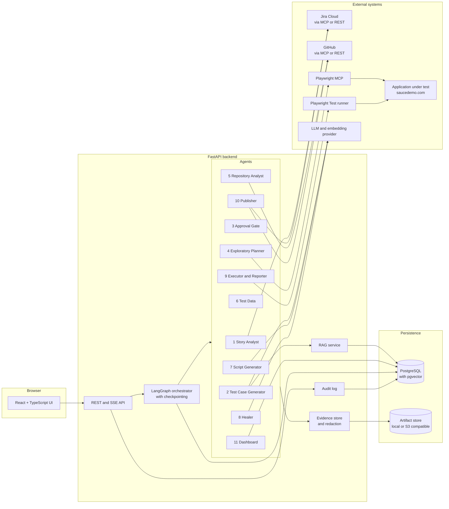
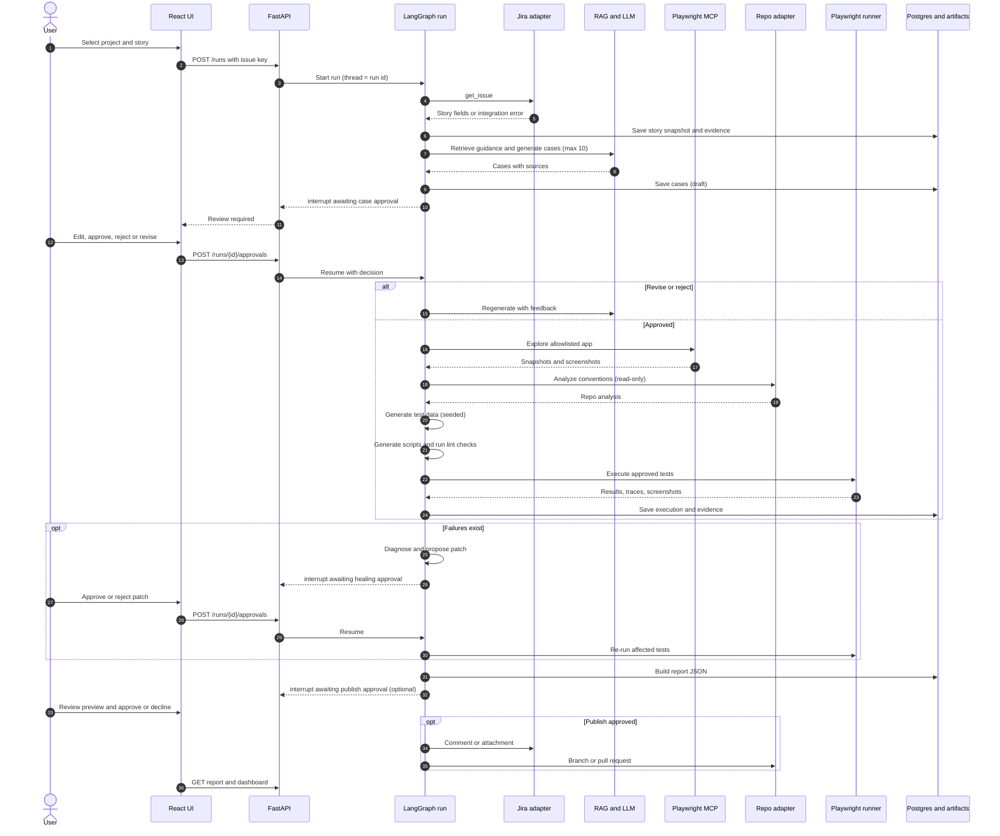
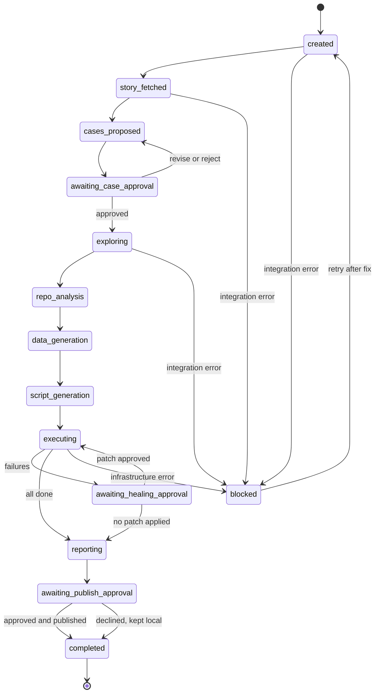

# QEFlow-AI Architecture

| | |
|---|---|
| Status | Proposed design, v0.1 (documentation only, nothing implemented) |
| Date | 2026-10-25 |
| Repository | <https://github.com/jyotinayak12/QEFlow-AI> |
| Jira board | <https://jyotinayak12-1784368206729.atlassian.net/jira/software/projects/KAN/boards/1> (project key KAN) |
| Application under test | <https://www.saucedemo.com/> |
| Related document | `End_to_End_QE_Multi_Agent_Implementation.md` (existing, 863 lines: stage-by-stage implementation rules) |

**How to read this document.** Every statement is tagged by origin where it matters:

- **[Verified]** observed directly during this review, with the method stated.
- **[Existing]** taken from a file already in the repository.
- **[Proposed]** a design choice made in this document. Not yet built or tested.
- **[Unresolved]** a decision or fact that must be settled before implementation (see section 19).

## 0. Review findings (what was and was not verified)

| Item | Result | How it was checked |
|---|---|---|
| GitHub repository | **[Verified]** Public, default branch `main`, 2 commits. | Read-only fetch of the repository page |
| Repository contents | **[Verified]** Only two files: `README.md` (title and one-line description, "An integrated platform covering the full QE lifecycle") and `End_to_End_QE_Multi_Agent_Implementation.md`. No source folders, package manifests, configuration files, tests, or earlier architecture document. | Repository file listing and fetch of the guide |
| Existing components | **[Verified]** None. The repository holds requirements and process rules only. Every component below is **[Proposed]**. | Same |
| Implementation guide | **[Existing]** Defines an 11-stage plan, a test case contract, a 10-test-case limit per story, mandatory approval gates, and an "inspect, plan, implement, verify, stop" loop per stage. This architecture follows it. | Fetch of the guide file |
| Jira board | **[Unverified]** The fetch returned only a page title (the board is a login-gated JavaScript app). Whether any stories exist in project KAN, which fields they carry, and whether an API credential works is unknown. | Read-only fetch |
| Jira, GitHub and Playwright MCP tools | **[Unverified]** No such tools were available in this session, so connectivity, tool names, and permissions are unknown. | Not testable here |
| saucedemo.com | **[Verified]** The site responds (page title "Swag Labs"). **[Unverified]** Its pages and flows: it is client-rendered, so no structure was observed. No DOM element, selector, or credential in this document comes from observation. | Read-only fetch |
| Write access to GitHub | **[Verified]** Not available in this session. This file was produced for you to review and commit yourself. | n/a |

Consequence: nothing below claims that Jira stories, page elements, or API responses exist. Examples use placeholders and are labelled as schema examples.

## 1. Project purpose and goals

QEFlow-AI is a multi-agent quality engineering platform that takes a real Jira user story and produces reviewed, traceable test cases, Playwright automation, execution evidence, and a results dashboard, with humans approving the steps that matter.

Goals:

1. **Traceability end to end:** Jira story, test case, script, execution result, report, each link preserved and queryable.
2. **Grounded generation:** test cases come from the actual story fields plus retrieved QE guidance, with sources cited.
3. **Human control:** nothing is automated, repaired, or published without an explicit, recorded approval.
4. **Evidence over assertion:** observations, results, and failures come from real tool output (browser sessions, runner output), never from model claims.
5. **Reuse:** generated automation follows the conventions of the target automation repository.
6. **Honest failure:** integration problems are surfaced clearly, never hidden behind mock data.

## 2. Scope and non-goals

In scope (first release):

- One Jira story per run, selected by the user from an authorized Jira project or board.
- Up to 10 test cases per story per generation request **[Existing]**.
- Exploration of one explicitly configured test application (initially saucedemo.com).
- Playwright test generation and execution, bounded healing proposals, publishing to Jira and GitHub after approval, HTML dashboard.
- A web UI for story selection, test case review, healing review, publish review, and results.

Non-goals:

- Testing production systems or running destructive actions.
- Automatic merging or pushing of generated code, or automatic Jira writes.
- Performance, security, or load testing.
- Mobile or API-only test generation (possible later, not designed here).
- Multi-tenant SaaS operation, billing, or fine-grained enterprise RBAC in release 1.
- Replacing a test management tool.
- Fine-tuning models.

## 3. Requirements

### 3.1 Functional

| ID | Requirement |
|---|---|
| FR-01 | List Jira projects, boards, and stories the connected user may access, with pagination and text filter. |
| FR-02 | Let the user select one story and retrieve all returned fields, including custom fields, preserving raw values. |
| FR-03 | Produce a normalized story record in addition to the raw fields. Missing or ambiguous requirements are marked unresolved, never guessed. |
| FR-04 | Generate at most 10 schema-valid test cases per generation request, each carrying the story key, source requirement reference, and evidence references. |
| FR-05 | Indicate whether generation used RAG sources or story-only context. |
| FR-06 | Pause at a human approval gate. Support approve, reject, and request revision with comments, and editing of cases. |
| FR-07 | Block exploration and script generation until the case set version is approved. |
| FR-08 | Explore the configured application with a real browser session and store page evidence (accessibility snapshots, screenshots, candidate locators) mapped to test cases. |
| FR-09 | Analyze the target automation repository (read-only) and produce a conventions report with file-path evidence. |
| FR-10 | Generate deterministic synthetic test data from approved scenarios, with a seed. |
| FR-11 | Generate Playwright scripts that map to approved test case IDs, follow detected conventions, and pass lint and type checks where configured. |
| FR-12 | Execute approved tests in an authorized environment, capture results and artifacts, and distinguish test failures from infrastructure failures. |
| FR-13 | Analyze failures from collected evidence and propose bounded patches. A patch is applied only after approval, then the affected test is re-run. |
| FR-14 | Publish selected artifacts (branch or pull request, Jira comment or attachment) only after a separate explicit approval with a preview of every write. |
| FR-15 | Present a dashboard of test cases, execution status, failures, evidence, and traceability, and export a static HTML file. |
| FR-16 | Resume an interrupted run from persisted state after a restart. |
| FR-17 | Record an audit trail of approvals, external writes, and integration failures. |
| FR-18 | Report integration status (Jira, GitHub, Playwright, LLM, database) on demand without exposing secrets. |
| FR-19 | Support an explicitly selected `mock` mode for development, labelled in the UI, in every record, and in every report. |

### 3.2 Non-functional

| ID | Requirement |
|---|---|
| NFR-01 | **Traceability:** every test case, result, and report entry resolves to a story key and evidence IDs. |
| NFR-02 | **Safety:** no external write, repair, or script generation without a recorded approval for the exact content version. |
| NFR-03 | **Secrets:** none in the repository, logs, prompts, traces, screenshots, or reports. |
| NFR-04 | **Determinism where possible:** seeded test data, pinned dependency versions, recorded LLM responses for regression tests. |
| NFR-05 | **Resumability:** a run survives a backend restart and resumes at the last checkpoint. |
| NFR-06 | **Observability:** structured logs and traces carrying run ID, story key, stage, tool, duration, status. |
| NFR-07 | **Timeouts and bounded retries** on every external call; no unbounded loops (healing max 3 attempts). |
| NFR-08 | **Idempotency:** repeating a request (approval, publish, execution start) does not duplicate effects. |
| NFR-09 | **Local first:** runs on one developer machine with Docker Compose. |
| NFR-10 | **Maintainability:** typed contracts between components, one module per agent, replaceable adapters for each integration. |
| NFR-11 | **Performance targets [Unresolved]:** to be baselined in Stage 0 (for example time from story selection to proposed cases). |
| NFR-12 | **Accessibility** of the UI to WCAG 2.1 AA as a target. |

## 4. High-level architecture

One modular backend with one orchestrator. Agents are modules inside it, not separate services. MCP servers expose tools and are called through adapters; they are not agents **[Existing rule]**.



Layer responsibilities:

| Layer | Responsibility |
|---|---|
| UI | Selection, review, approval, progress, dashboard. No business rules. |
| API | Authentication, validation, resuming the graph, serving results. Thin. |
| Orchestrator | Run state machine, routing, interrupts, checkpoints, retries. |
| Agents | One responsibility each. Pure functions of state plus adapter calls. |
| Adapters | Jira, GitHub, Playwright, LLM, embedding. One port (interface) each, real and mock implementations. |
| Persistence | Relational data, vectors, checkpoints, artifacts. |

## 5. Components and agent responsibilities

### 5.1 Technology choices and alternatives

All are **[Proposed]**. The prompt that requested this document lists them as candidates, not requirements.

| Concern | Proposed choice | Why | Alternatives | Verify before use |
|---|---|---|---|---|
| Backend | Python 3.12 with FastAPI | Typed request and response models (Pydantic), async I/O, and the strongest LangGraph, RAG, and evaluation ecosystem | Node.js with LangGraph.js (one language end to end, which suits a Playwright TypeScript team) | Team Python skill level (see D-01) |
| Orchestration | LangGraph with Postgres checkpointer and `interrupt()` | Durable pause and resume for human approval, explicit graph, replayable state | Temporal (stronger durability, heavier), plain state machine (simplest, no pause and resume tooling) | LangGraph version and checkpointer API at implementation time |
| Frontend | React with TypeScript, Vite | Matches the requested stack, typed API client generated from OpenAPI | Streamlit or Gradio (faster to build, weaker review UX) | none |
| Browser automation | Playwright | Requested; traces, accessibility snapshots, and a JSON reporter provide the evidence the Healer needs | Selenium (weaker tracing) | Browser install in container |
| Generated test language | TypeScript for `@playwright/test` | Matches the dominant Playwright ecosystem and the repository analysis target; runner invoked as a subprocess | Python with pytest-playwright (single language) | Conventions of the target repository (see D-02) |
| Persistence | PostgreSQL 16 with the `pgvector` extension | One database for application data, approvals, results, checkpoints, and vectors keeps operations simple | SQLite for local only; Qdrant or Chroma for vectors if scale or features require | pgvector availability in the chosen host |
| Artifact storage | Local filesystem behind a storage interface, S3-compatible later | Screenshots, traces, reports are files; database stores metadata and hashes | Store blobs in Postgres (not recommended) | none |
| RAG | Custom thin pipeline: loader, chunker, embedder, hybrid retriever (vector plus keyword), reranker optional | Needs source attribution and evaluation hooks; avoids heavy framework lock-in | LlamaIndex, LangChain retrievers | Corpus size and quality (see D-05) |
| LLM and embeddings | **Not selected** | Needs a decision on provider, cost, data policy | Any provider behind an `LLMPort` | D-04 |
| Jira access | Port with MCP adapter (default, per the guide) and REST adapter (fallback and test) | The guide specifies MCP; REST gives a verifiable path if the MCP lacks listing tools | Atlassian remote MCP (OAuth), `mcp-atlassian` (API token) | Exact tools exposed by the chosen server (D-03) |
| GitHub access | Port with MCP or REST adapter, read-only first | Least privilege | `git` CLI over SSH or token | Token scopes |
| Observability | Structured JSON logs, OpenTelemetry traces, LangFuse for LLM traces (candidate) | Per-stage visibility and cost tracking | Arize Phoenix, plain logs | Self-host or cloud decision |
| Reporting | Versioned JSON as source of truth, React dashboard, static HTML export | JSON is verifiable; HTML is shareable | Allure report (can supplement) | none |
| Auth for the web app | Not selected; OIDC login when more than one user (D-07) | Reviewer identity is needed for approvals | Single-user local token for release 1 | D-07 |

### 5.2 Cross-cutting component rules

- Every agent has the signature `run(state, ports) -> StateUpdate`, with typed input and output models. Agents never read environment variables or open network connections directly; they use injected ports.
- Every port has a `live` implementation and a `mock` implementation. Choosing `mock` is an explicit run option, recorded as `data_source` on every record and shown in the UI. A live adapter that fails never falls back to mock.
- Every agent writes evidence records for what it observed, and every artifact it produces references them.
- Every agent call is wrapped by the orchestrator with timeout, bounded retry, structured logging, and error classification (section 15).

### 5.3 Agent specifications

#### Agent 1: Story Analyst

- **Purpose:** retrieve the selected real Jira story and produce a traceable normalized record.
- **Inputs:** Jira site reference (configuration), project or board, optional filter, selected issue key.
- **Outputs:** `Story` (section 12.1) with `raw_fields`, normalized fields, `retrieved_at`, `data_source`; evidence records of kind `jira_field`.
- **Interfaces:** `JiraPort.list_projects`, `list_boards`, `search_issues`, `get_issue`. Read-only.
- **Processing:** list with pagination, user selects one issue, fetch all fields including custom fields, preserve raw identifiers and values, map acceptance criteria only if a configured field mapping identifies it (otherwise `acceptance_criteria = null` and a `unresolved_requirements` note), store a snapshot.
- **Errors:** auth failure, permission denied, rate limit (retry with backoff), empty list, issue not found, missing fields. Each yields a clear `blocked` status with the integration error; no substitution of invented data.
- **Security:** least-privilege read scope; story text is untrusted input and is never executed or used to build commands; no secrets in logs.
- **Acceptance:** the selected key and fields reach downstream stages unchanged; no Jira write occurs; pagination, empty, and error states handled; unit tests for normalization, missing and custom fields; UI shows live versus mock.

#### Agent 2: Test Case Generator (RAG)

- **Purpose:** generate up to 10 grounded, schema-valid test cases from the story and retrieved QE guidance.
- **Inputs:** `Story`, retrieval corpus (section 7), optional reviewer feedback from a prior round, generation request ID.
- **Outputs:** `TestCase[]` (section 12.2) with `story_key`, `source_requirement`, `rag_sources`, `evidence_refs`, `generation_mode` (`rag` or `story_only`), `status = draft`, `approved_by_user = false`, `actual_result = null`; a `GenerationReport` with unresolved requirements and coverage by category.
- **Interfaces:** `RetrieverPort`, `LLMPort`, schema validator.
- **Processing:** build one query per acceptance criterion or requirement plus one story-level query, retrieve with attribution, assemble a bounded context, generate structured output, validate programmatically (schema, unique IDs, valid categories, limit of 10, no populated `actual_result`, every case has a source requirement or an explicit `unresolved` marker), repair or reject invalid output, record the retrieval trace.
- **Errors:** empty retrieval (proceed as `story_only` and say so), LLM timeout or malformed output (bounded retry, then `blocked`), more than 10 cases (truncate by priority and report), duplicates.
- **Security:** retrieved text and story text are data, not instructions; prompt isolates them; output is validated, never executed.
- **Acceptance:** never more than 10 cases; every case traceable to story and sources; `generation_mode` truthful; schema validation tests cover malformed, duplicate, unsupported, and over-limit output.

#### Agent 3: Human Approval Gate

- **Purpose:** pause the run until a human approves, rejects, or requests changes to a specific version of the test case set.
- **Inputs:** `TestCase[]`, case set `version`.
- **Outputs:** `Approval` (section 12.4); cases updated to `approved` or `needs_revision`.
- **Interfaces:** LangGraph `interrupt()`, Postgres checkpointer, approvals API.
- **Processing:** details in section 8.
- **Errors:** stale version, duplicate submission, unauthorized reviewer, resume after restart.
- **Security:** reviewer identity from authenticated context only; approval bound to content hash.
- **Acceptance:** run pauses and resumes from persisted state; downstream stages provably unreachable without an approval for the current version; rejected or revised cases never become approved silently.

#### Agent 4: Exploratory Planner

- **Purpose:** explore the authorized target application in a real browser and collect actual page evidence relevant to approved cases.
- **Inputs:** approved `TestCase[]`, configured `base_url` and allowed host list, test credentials from the secret store.
- **Outputs:** `ExplorationReport` with visited pages, accessibility snapshots, screenshots, candidate locators (role and name based first), mapped to test case IDs; evidence records of kinds `page_snapshot` and `screenshot`.
- **Interfaces:** `BrowserPort` (Playwright MCP adapter).
- **Processing:** verify the URL is allowlisted, open a session, walk only the flows needed by approved cases, record each observation with its URL and timestamp, stop at blockers (MFA, CAPTCHA, missing account) and report them.
- **Errors:** navigation failure, timeout, blocked flow, out-of-scope navigation (blocked and logged), tool unavailable (run `blocked`, no fabricated observations).
- **Security:** allowlist enforcement, no destructive actions without separate approval, credentials never written to evidence, evidence redacted before storage.
- **Acceptance:** every locator candidate carries an evidence ID from an actual session; if no session ran, the report says so; out-of-scope navigation is prevented.

#### Agent 5: Repository Analyst

- **Purpose:** learn the conventions of the target automation repository so generated code fits it.
- **Inputs:** target repository reference (D-02), read-only credential.
- **Outputs:** `RepoAnalysis`: language, package manager, Playwright version, folder layout, config, fixtures, page objects, helper utilities, lint and type check commands, test run command, each with file-path evidence; list of assumptions and missing setup.
- **Interfaces:** `RepoPort` (GitHub or filesystem), read-only.
- **Processing:** read manifests and config first, then structure, then a few representative tests and page objects; skip secret files; cache by commit SHA.
- **Errors:** repository not accessible, empty repository (report "no conventions found" and propose defaults for approval, do not pretend), unsupported layout.
- **Security:** never read or print `.env` or credential files; no writes.
- **Acceptance:** each claim cites a file path; versions come from manifests; no files modified.
- **Note [Verified]:** the QEFlow-AI repository currently contains no test code, so this agent would report an empty analysis for it. The target automation location is unresolved (D-02).

#### Agent 6: Test Data Agent

- **Purpose:** produce safe, reproducible synthetic data for approved scenarios.
- **Inputs:** approved cases, `ExplorationReport` (field names and constraints observed), `RepoAnalysis` (fixture format), seed.
- **Outputs:** `TestDataSet` per case (`positive`, `negative`, `edge` partitions), the generator seed, fixture files in the repository's format.
- **Processing:** the LLM produces only a data specification (fields, constraints, variants). A deterministic Faker.js generator materializes values from the specification and a seed. Faker.js is justified because generated tests are TypeScript and it is seedable; the Python Faker library is the alternative if the generated suite is Python.
- **Errors:** unsupported constraint, uniqueness conflict (regenerate with next seed, bounded), specification invalid.
- **Security:** no real personal data; credentials for the application come from the secret store, never from fixtures.
- **Acceptance:** same seed gives identical data; values satisfy constraints; negative and boundary data link to specific case IDs.

#### Agent 7: Script Generator

- **Purpose:** generate Playwright tests from approved cases, exploration evidence, repository conventions, and test data.
- **Inputs:** approved cases, `ExplorationReport`, `RepoAnalysis`, `TestDataSet`.
- **Outputs:** script files and a `ScriptManifest` mapping each file and test name to test case IDs and story key; a diff for review; evidence of lint and type check results.
- **Interfaces:** `LLMPort`, `FilesystemPort` (writes limited to a configured automation directory).
- **Processing:** generate one test per approved case with story key and case ID in the title or annotations, accessible locators from observed evidence, assertions derived from `expected_result`, reuse of page objects and fixtures; run formatter, linter, type check, and `playwright test --list`; loop on tool errors a bounded number of times.
- **Errors:** missing evidence for a step (emit a documented `test.fixme` with reason, never a guessed selector), lint or compile failure after the retry budget (run `blocked` with details).
- **Security:** writes only inside the allowed directory, no secrets in code, no execution against unapproved environments.
- **Acceptance:** every script maps to an approved case; assertions trace to expected results; checks pass or failures are reported; assumptions listed.

#### Agent 8: Healer

- **Purpose:** diagnose failed tests from real artifacts and propose bounded repairs.
- **Inputs:** `Failure` records, traces, DOM or accessibility snapshots, screenshots, console and runner logs, the script and its approved case.
- **Outputs:** `HealingProposal` (section 12.7): classification, diagnosis, confidence, unified diff, evidence references.
- **Processing:** classify as locator, timing, data, environment, application defect, or expectation problem; propose the smallest change; a guard rejects any diff that touches assertions, expected values, authentication steps, or removes or skips a test; application defects and environment problems are reported, not patched.
- **Approval:** a proposal is applied only after an approval of kind `healing_patch`; after applying, the affected test is re-run and before and after evidence is kept; maximum 3 attempts per test.
- **Errors:** missing artifacts (confidence reduced, may decline to propose), guard violation (proposal discarded and logged).
- **Security:** same as Agent 7; no change to test intent.
- **Acceptance:** diagnosis cites evidence and states uncertainty; a failed test stays failed until a verified re-run passes; genuine defects remain visible in the report.

#### Agent 9: Executor and Reporter

- **Purpose:** run approved tests and produce evidence-based, machine-readable results.
- **Inputs:** `ScriptManifest`, execution configuration, environment reference.
- **Outputs:** `Execution` with `TestResult[]` and `Failure[]` (section 12.5, 12.6), artifact index, runner exit code.
- **Processing:** validate environment against the allowlist, build the runner command from approved test case IDs (never from story or model text), run with the JSON reporter and trace retention on failure, parse results, map each result to a case ID, set `actual_result` from observed output, redact artifacts, store with hashes.
- **Errors:** runner crash, browser install missing, timeout (infrastructure failure, status `blocked`, not `failed`), unmappable result (reported as an anomaly).
- **Security:** argument-array execution without a shell, working directory and environment restricted, secrets masked in logs and traces.
- **Acceptance:** counts reconcile with records; every result maps to an approved case; infrastructure and test failures are distinguishable; missing artifacts marked unavailable.

#### Agent 10: Publisher

- **Purpose:** write approved artifacts to Jira and GitHub, only after explicit authorization.
- **Inputs:** approved artifacts, destinations, `publish` approval.
- **Outputs:** `PublishOperation[]` with destination, content hash, external ID, status.
- **Processing:** build a preview of every write (branch or pull request contents, Jira comment text, attachments), wait for an approval of kind `publish` bound to the preview hash, perform each write with an idempotency key, record results, report partial success accurately.
- **Errors:** permission denied, protected branch, rate limit, one destination failing after another succeeded (reported per destination), retry that would duplicate (prevented by idempotency key lookup).
- **Security:** least privilege, branch or pull request instead of direct writes to protected branches, only sanitized approved artifacts, audit entry per write.
- **Acceptance:** no write before approval; content equals the approved preview; external responses stored; tests use mocked clients, live writes only against an authorized test destination.

#### Agent 11: Dashboard Agent

- **Purpose:** present validated results with traceability.
- **Inputs:** `Report` JSON built from persisted records.
- **Outputs:** API payloads for the React dashboard and a static HTML export.
- **Processing:** compute summaries from stored results only, build the traceability matrix story to case to script to result, distinguish missing data from zero, link evidence only when it exists and the viewer is authorized.
- **Errors:** empty or partial results (explicit empty state), malformed data (rejected with a validation error).
- **Security:** all untrusted text escaped, no inline script from data, static export contains no secrets.
- **Acceptance:** dashboard totals equal source JSON; tested with passed, failed, skipped, blocked, and empty fixtures; traceability visible.

### 5.4 Supporting components

| Component | Responsibility |
|---|---|
| RAG service | Ingestion, retrieval, attribution, evaluation hooks (section 7). |
| Evidence store | Persist artifacts with SHA-256, capture metadata, redaction status, and access control. |
| Audit log | Append-only record of approvals, external writes, and integration failures. |
| Integration status service | Checks each adapter without printing secrets and reports `ok`, `degraded`, `unreachable`, or `unauthorized`. |
| Config service | Loads and validates settings at startup and fails fast with actionable messages. |

## 6. End-to-end workflow

### 6.1 Sequence



### 6.2 Run status model



`blocked` always carries an `integration_error` object (adapter, operation, classified reason, sanitized message). A blocked run can be resumed from its last checkpoint once the cause is fixed. Statuses of cases (`draft`, `needs_revision`, `approved`, `executed`, `passed`, `failed`, `blocked`) are tracked separately from run status, as the existing guide requires.

## 7. RAG design: ingestion, retrieval, grounding, traceability

### 7.1 Corpus **[Unresolved: D-05]**

Candidate sources, each requiring owner approval before use: team test design standards and templates, previously approved test cases, naming and priority rules, domain glossaries, defect post-mortems. Nothing is ingested without a manifest entry stating owner, version, and licence or confidentiality class. The repository has no corpus today **[Verified]**; `story_only` generation is the honest default until one exists.

### 7.2 Ingestion

1. **Manifest:** `rag-corpus/manifest.yaml` lists each source (path or URL, type, owner, version, sensitivity). Only listed sources are processed.
2. **Load:** parsers for Markdown, text, and CSV or JSON test case exports. Unsupported types are rejected with a message.
3. **Clean:** strip boilerplate, normalize whitespace, detect and mask secrets and personal data (reject chunk if masking fails).
4. **Chunk:** structure-aware. One approved test case is one chunk. Documents split by heading with a size cap (initial 500 to 800 tokens, 10 percent overlap, to be tuned by evaluation).
5. **Metadata:** `source_id`, `source_version`, `section`, `doc_type` (`standard`, `approved_case`, `glossary`, `defect`), `module`, `ingested_at`, `content_hash`, `sensitivity`.
6. **Embed and index:** embeddings stored in pgvector with a keyword index (PostgreSQL full text search) for hybrid retrieval. Re-ingestion is idempotent by `content_hash`; removed sources are tombstoned.
7. **Feedback loop (optional, approval-gated):** reviewer-approved cases may be proposed for the corpus, never added automatically.

### 7.3 Retrieval

1. Query construction per acceptance criterion or requirement plus a story-level query. If the story has no identified criteria, queries are built from summary and description and the gap is reported.
2. Hybrid search: top-k vector results merged with keyword results (reciprocal rank fusion), filtered by `doc_type`, `module`, and sensitivity.
3. Optional reranking of the merged list; initial setting `k = 8` per query, final context budget capped.
4. Every retrieved chunk is returned with `chunk_id`, `source_id`, `source_version`, `score`, and text.
5. The retrieval trace (queries, chunk IDs, scores) is stored as evidence of kind `rag_chunk`.

### 7.4 Grounding

- The prompt separates three labelled blocks: **STORY** (verbatim Jira fields), **GUIDANCE** (retrieved chunks with IDs), **TASK**. Instructions state that both STORY and GUIDANCE are data.
- Each generated case must populate `source_requirement` (the story field or criterion it verifies) and `rag_sources` (chunk IDs actually used, possibly empty). IDs not present in the trace are rejected by the validator.
- If a behaviour is not stated in the story, the case either quotes the guidance that justifies the check or is marked `unresolved_assumption` and flagged for reviewer attention. The generator may not state an unobserved business rule as fact.
- `generation_mode = story_only` when the retrieval returned nothing usable, and the UI says so.

### 7.5 Traceability chain

```text
Jira issue key and field names
   -> TestCase.story_key + source_requirement + rag_sources + evidence_refs
   -> Script (manifest: file, test title, test_case_ids)
   -> TestResult.test_case_id + evidence_refs (trace, screenshot)
   -> Report traceability matrix
```

### 7.6 Evaluation

| Metric | Method | Initial target |
|---|---|---|
| Context precision and recall | Ragas style evaluation on a golden set of stories with labelled relevant chunks | Baseline in Stage 2, then set targets |
| Faithfulness (cases supported by story or sources) | LLM-assisted check plus reviewer sampling | Baseline first |
| Requirement coverage | Share of acceptance criteria with at least one case | Reported per run |
| Schema validity rate | Programmatic | 100 percent after validation and repair |
| Duplicate rate | Embedding similarity within a set | Reported |
| Reviewer acceptance rate and edit rate | From approval records | Reported, used to tune prompts |

## 8. Human approval and interrupt/resume workflow

### 8.1 Approval kinds

| Kind | Triggers | Subject | Blocks |
|---|---|---|---|
| `test_cases` | After generation | Case set at a given `version` and `content_hash` | Exploration, data, scripts |
| `healing_patch` | After a proposal exists | One `HealingProposal` and its diff hash | Applying the patch |
| `publish` | After report is built | Publish preview hash covering every external write | Any Jira or GitHub write |

Execution of tests runs only in an allowlisted environment configured by an administrator; starting an execution against a new environment requires a separate recorded `environment` authorization (an administrator action, not a model decision).

### 8.2 Mechanics

1. The graph runs with `thread_id = run_id` and a Postgres checkpointer.
2. At a gate, the node calls `interrupt(payload)` where the payload contains the subject ID, `version`, and `content_hash`. State is persisted and the API returns the run as `awaiting_*_approval`.
3. The reviewer edits or decides in the UI. Edits create a new case set `version` and invalidate any pending approval for the older version.
4. `POST /runs/{run_id}/approvals` carries `kind`, `subject_id`, `subject_version`, `decision` (`approved`, `rejected`, `revise`), `comment`, and an `Idempotency-Key` header.
5. The API validates: reviewer authenticated and authorized, run is awaiting this kind, `subject_version` equals the current version, key not seen before. Otherwise it returns `409` (stale or duplicate) or `403`.
6. On success it stores the `Approval`, writes an audit entry, and resumes the graph with `Command(resume=decision)` in the same transaction boundary used for idempotency.
7. Routing: `approved` continues; `revise` returns to generation with comments as input; `rejected` ends the branch and the run completes without automation.
8. After a backend restart, the run is still `awaiting_*`; resume works because everything needed is in the checkpoint and the database.

### 8.3 Safety properties (each backed by an automated test)

- No path in the graph reaches exploration, script generation, patch application, or publishing without a matching approval record for the current version.
- An approval for version N cannot be used for version N+1.
- Submitting the same approval twice has the same effect as once.
- Rejected or revised cases never carry `approved_by_user = true`.
- Reviewer identity is recorded only from authenticated context.

## 9. Data flow

| Step | From | To | Data | Stored |
|---|---|---|---|---|
| 1 | UI | API | Project, story selection | Run row |
| 2 | API | Jira adapter | Read requests | none |
| 3 | Jira adapter | Orchestrator | Issue fields | `stories`, evidence `jira_field` |
| 4 | Orchestrator | RAG service | Story-derived queries | Retrieval trace evidence |
| 5 | RAG service | LLM | STORY, GUIDANCE, TASK | Prompt metadata (hash, model, tokens), not secrets |
| 6 | LLM | Orchestrator | Structured cases | `test_cases` (version 1) |
| 7 | UI | API | Edits and decision | New version, `approvals`, audit |
| 8 | Orchestrator | Playwright MCP | Navigation within allowlist | Evidence files with hashes |
| 9 | Orchestrator | Repo adapter | Read requests | `repo_analyses` |
| 10 | Orchestrator | Faker generator | Data specification and seed | Fixture files, `test_data_sets` |
| 11 | Orchestrator | Filesystem | Generated scripts | Script files, `script_manifests` |
| 12 | Orchestrator | Runner | Approved test IDs | Raw runner output, traces, screenshots |
| 13 | Runner output | Orchestrator | Parsed results | `executions`, `test_results`, `failures` |
| 14 | Healer | UI via API | Diff and diagnosis | `healing_proposals` |
| 15 | Orchestrator | Report builder | Persisted records only | `reports` JSON |
| 16 | Publisher | Jira and GitHub | Approved previews | `publish_operations`, audit |
| 17 | API | UI | Report and evidence links | none |

Rules: data moves only through typed contracts; models receive the minimum fields needed; secrets never enter prompts; evidence passes through redaction before it is stored; the report is built from stored records, not from model output.

## 10. Proposed folder structure

**[Verified]** today the repository contains only `README.md` and `End_to_End_QE_Multi_Agent_Implementation.md`. Everything else is **[Proposed]** and should be created stage by stage, not all at once.

```text
QEFlow-AI/
├── architecture.md                      # this document
├── README.md
├── End_to_End_QE_Multi_Agent_Implementation.md   # existing implementation rules
├── .env.example                         # placeholder names only, never real values
├── docker-compose.yml                   # postgres (pgvector), backend, frontend
├── .github/workflows/                   # lint, type check, tests
├── docs/
│   ├── adr/                             # one decision record per resolved D-xx item
│   └── diagrams/
├── backend/
│   ├── pyproject.toml
│   ├── app/
│   │   ├── main.py
│   │   ├── api/                         # routers: health, integrations, jira, runs, test_cases,
│   │   │                                #   approvals, exploration, scripts, executions,
│   │   │                                #   healing, publish, reports, audit, evidence
│   │   ├── core/                        # config, logging, security, errors, idempotency
│   │   ├── domain/                      # pydantic models (section 12), enums
│   │   ├── graph/                       # state.py, builder.py, routing.py, checkpoint.py
│   │   ├── agents/
│   │   │   ├── story_analyst/
│   │   │   ├── test_case_generator/
│   │   │   ├── approval_gate/
│   │   │   ├── exploratory_planner/
│   │   │   ├── repo_analyst/
│   │   │   ├── test_data/
│   │   │   ├── script_generator/
│   │   │   ├── healer/
│   │   │   ├── executor_reporter/
│   │   │   ├── publisher/
│   │   │   └── dashboard/
│   │   ├── ports/                       # JiraPort, RepoPort, BrowserPort, LLMPort, RetrieverPort,
│   │   │                                #   FilesystemPort, RunnerPort (abstract interfaces)
│   │   ├── adapters/
│   │   │   ├── jira/                    # mcp_adapter.py, rest_adapter.py, mock_adapter.py
│   │   │   ├── github/
│   │   │   ├── playwright/              # mcp_browser.py, runner.py
│   │   │   └── llm/
│   │   ├── rag/                         # ingest.py, chunking.py, embeddings.py, retriever.py, eval/
│   │   ├── evidence/                    # store.py, redaction.py, hashing.py
│   │   └── persistence/                 # db.py, repositories/, migrations/
│   └── tests/
│       ├── unit/  integration/  e2e/  fixtures/  evals/
├── frontend/
│   ├── package.json
│   └── src/
│       ├── api/                         # client generated from OpenAPI
│       ├── pages/                       # StorySelect, CaseReview, RunProgress, Healing, Publish, Dashboard
│       └── components/
├── automation/                          # generated Playwright project (location is D-02)
│   ├── package.json
│   ├── playwright.config.ts
│   ├── tests/  pages/  fixtures/
├── rag-corpus/
│   ├── manifest.yaml
│   └── ...                              # approved sources only
└── artifacts/                           # git-ignored: screenshots, traces, reports
```

## 11. API specification

Base path `/api/v1`. JSON over HTTPS. Errors use one envelope:

```json
{ "error": { "code": "string", "message": "string", "details": {}, "request_id": "string" } }
```

Mutating requests accept an `Idempotency-Key` header. Long operations return `202` with a run or execution resource and report progress through server-sent events.

### 11.1 Endpoints

| Method and path | Purpose | Notes |
|---|---|---|
| `GET /health` | Liveness | No secrets |
| `GET /integrations/status` | Status of Jira, GitHub, Playwright, LLM, database | Values are `ok`, `degraded`, `unreachable`, `unauthorized`, `not_configured` |
| `GET /jira/projects` | Authorized projects | Paginated (`cursor`) |
| `GET /jira/boards?project={key}` | Boards | Paginated |
| `GET /jira/issues?project={key}&q={text}&cursor={c}` | Stories | Paginated, filterable |
| `POST /runs` | Create run for one story | Body below; starts Stage 1 |
| `GET /runs` and `GET /runs/{run_id}` | List and read runs | Includes status, `data_source` |
| `GET /runs/{run_id}/story` | Story snapshot | Raw and normalized |
| `POST /runs/{run_id}/test-cases:generate` | Request (re)generation | Optional `feedback`; max 10 cases |
| `GET /runs/{run_id}/test-cases` | Current case set and version | |
| `PATCH /runs/{run_id}/test-cases/{case_id}` | Reviewer edit | Creates a new set version |
| `POST /runs/{run_id}/approvals` | Record a decision | Kinds `test_cases`, `healing_patch`, `publish` |
| `GET /runs/{run_id}/exploration` | Exploration report | |
| `GET /runs/{run_id}/repo-analysis` | Conventions report | |
| `GET /runs/{run_id}/test-data` | Data sets and seed | |
| `GET /runs/{run_id}/scripts` | Manifest and diff | |
| `POST /runs/{run_id}/executions` | Start execution | Requires approved cases and allowlisted environment |
| `GET /runs/{run_id}/executions/{execution_id}` | Execution and results | |
| `GET /runs/{run_id}/failures` | Failures | |
| `GET /runs/{run_id}/healing-proposals` | Proposals | Decision via approvals endpoint |
| `POST /runs/{run_id}/publish/preview` | Build preview of all external writes | Returns `preview_hash` |
| `POST /runs/{run_id}/publish` | Execute approved publish | Requires `approval_id` bound to `preview_hash` |
| `GET /runs/{run_id}/report` | Report JSON | |
| `GET /runs/{run_id}/dashboard.html` | Static HTML export | |
| `GET /runs/{run_id}/events` | Server-sent progress events | |
| `GET /runs/{run_id}/audit` | Audit trail | Reviewer or admin role |
| `GET /evidence/{evidence_id}` | Evidence file or metadata | Authorization checked |

### 11.2 Example payloads (schema examples with placeholders, not real data)

Create run:

```json
// POST /api/v1/runs
{
  "issue_key": "KAN-<number>",
  "mode": "live",
  "target_environment": "<name from the allowlist>"
}
```

```json
// 201 Created
{
  "run_id": "<uuid>",
  "status": "created",
  "data_source": "live",
  "issue_key": "KAN-<number>",
  "created_at": "<ISO-8601>"
}
```

Integration failure (no fallback to mock):

```json
// 502 Bad Gateway
{
  "error": {
    "code": "integration_unavailable",
    "message": "Jira could not be reached or the credential was rejected.",
    "details": { "adapter": "jira", "operation": "get_issue", "reason": "unauthorized" },
    "request_id": "<id>"
  }
}
```

Record an approval:

```json
// POST /api/v1/runs/{run_id}/approvals   Idempotency-Key: <uuid>
{
  "kind": "test_cases",
  "subject_id": "<case set id>",
  "subject_version": 3,
  "decision": "approved",
  "comment": "<optional text>"
}
```

```json
// 200 OK
{
  "approval_id": "<uuid>",
  "run_status": "exploring",
  "decided_by": "<authenticated reviewer id>",
  "decided_at": "<ISO-8601>"
}
```

Stale approval:

```json
// 409 Conflict
{ "error": { "code": "stale_subject_version", "message": "Test cases changed after this review began.", "details": { "current_version": 4 }, "request_id": "<id>" } }
```

Execution results (shape only; values come from the runner):

```json
// GET /api/v1/runs/{run_id}/executions/{execution_id}
{
  "execution_id": "<uuid>",
  "status": "completed",
  "summary": { "total": 0, "passed": 0, "failed": 0, "skipped": 0, "blocked": 0 },
  "results": [
    { "test_case_id": "<id>", "status": "passed", "duration_ms": 0,
      "actual_result": "<observed>", "expected_result": "<approved>",
      "evidence_refs": ["<evidence id>"] }
  ]
}
```

## 12. Data models and contracts

Pydantic models are the source of truth. The OpenAPI schema is generated from them and the frontend client is generated from OpenAPI. Every persisted model carries `data_source: "live" | "mock"` and `schema_version`. Sketches below show fields and types, not final code. The test case fields follow the existing guide **[Existing]**; additions are **[Proposed]**.

### 12.1 Story

```python
class Story(BaseModel):
    story_id: UUID
    run_id: UUID
    source: Literal["jira"]
    data_source: Literal["live", "mock"]
    site_id: str                      # configured reference, not a secret
    project_key: str
    issue_key: str
    issue_url: str | None
    summary: str | None
    description: str | None
    issue_type: str | None
    status: str | None
    priority: str | None
    assignee: str | None
    reporter: str | None
    labels: list[str] = []
    components: list[str] = []
    fix_versions: list[str] = []
    acceptance_criteria: str | None   # only if a configured field mapping identifies it
    unresolved_requirements: list[str] = []
    raw_fields: dict[str, Any]        # original field ids and values, untouched
    retrieved_at: datetime
    schema_version: int
```

### 12.2 TestCase (set versioned as a whole)

```python
class TestCase(BaseModel):
    id: str                           # stable within the run, for example "<run-short-id>-TC-001"
    run_id: UUID
    set_version: int
    story_key: str
    category: Literal["critical", "positive", "negative", "edge"]
    description: str
    steps: list[str]                  # ordered, actionable
    expected_result: str
    actual_result: str | None = None  # null until execution or explicit reviewer input
    approved_by_user: bool = False
    severity: Literal["critical", "major", "minor", "trivial"]   # [Proposed enum]
    priority: Literal["P0", "P1", "P2", "P3"]                    # [Proposed enum]
    source_requirement: str | None    # field or criterion reference; null means unresolved
    unresolved_assumption: bool = False
    rag_sources: list[str] = []       # chunk ids actually used
    evidence_refs: list[UUID] = []
    generation_mode: Literal["rag", "story_only"]
    status: Literal["draft", "needs_revision", "approved", "executed", "passed", "failed", "blocked"]
    created_at: datetime
    updated_at: datetime
    data_source: Literal["live", "mock"]
```

Constraints enforced by validators: at most 10 cases per generation request, unique `id`, `actual_result is None` before an execution exists, `approved_by_user` only set by the approval service.

### 12.3 Evidence

```python
class Evidence(BaseModel):
    evidence_id: UUID
    run_id: UUID
    kind: Literal["jira_field", "rag_chunk", "page_snapshot", "screenshot", "dom_snapshot",
                  "trace", "console_log", "runner_output", "repo_file", "diff"]
    uri: str                          # path or object key in the artifact store
    sha256: str
    captured_at: datetime
    captured_by: str                  # agent name
    tool: str                         # adapter and tool, for example "playwright_mcp.snapshot"
    source_url: str | None            # page URL for browser evidence
    redaction_status: Literal["clean", "redacted", "failed"]   # "failed" blocks storage
    size_bytes: int
```

### 12.4 Approval

```python
class Approval(BaseModel):
    approval_id: UUID
    run_id: UUID
    kind: Literal["test_cases", "healing_patch", "publish"]
    subject_id: str
    subject_version: int
    subject_hash: str
    decision: Literal["approved", "rejected", "revise"]
    comment: str | None
    reviewer_id: str                  # from authenticated context only
    decided_at: datetime
    idempotency_key: str
```

### 12.5 Execution and TestResult

```python
class Execution(BaseModel):
    execution_id: UUID
    run_id: UUID
    environment: str
    base_url: str
    started_at: datetime
    finished_at: datetime | None
    runner_exit_code: int | None
    status: Literal["running", "completed", "infrastructure_failure"]
    summary: ResultSummary            # total, passed, failed, skipped, blocked (must reconcile)
    attempt: int                      # increments after an approved patch and re-run
    artifact_index: list[UUID]

class TestResult(BaseModel):
    execution_id: UUID
    test_case_id: str
    script_ref: str                   # file and test title
    status: Literal["passed", "failed", "skipped", "blocked"]
    duration_ms: int
    actual_result: str | None         # from observed output only
    expected_result: str
    error: str | None                 # sanitized
    evidence_refs: list[UUID]
```

### 12.6 Failure and HealingProposal

```python
class Failure(BaseModel):
    failure_id: UUID
    execution_id: UUID
    test_case_id: str
    classification: Literal["locator", "timing", "data", "environment",
                            "application_defect", "expectation", "unknown"]
    error_message: str                # sanitized
    evidence_refs: list[UUID]
    first_seen_at: datetime

class HealingProposal(BaseModel):
    proposal_id: UUID
    failure_id: UUID
    attempt_no: int                   # max 3
    diagnosis: str
    confidence: Literal["low", "medium", "high"]
    uncertainty_notes: str
    files: list[str]
    unified_diff: str
    guard_result: Literal["passed", "rejected_assertion_change", "rejected_other"]
    evidence_refs: list[UUID]
    status: Literal["proposed", "approved", "rejected", "applied", "verified", "failed_verification"]
```

### 12.7 Report

```python
class Report(BaseModel):
    report_id: UUID
    run_id: UUID
    schema_version: int
    data_source: Literal["live", "mock"]
    story: StorySummary
    generation: GenerationSummary     # mode, retrieval summary, unresolved requirements
    approvals: list[ApprovalSummary]
    execution: ExecutionSummary       # counts reconcile with results
    traceability: list[TraceRow]      # story_key, test_case_id, script_ref, result, evidence ids
    failures: list[FailureSummary]
    healing: list[HealingSummary]
    publish: list[PublishSummary]
    generated_at: datetime
```

### 12.8 Relationships

`Run 1—1 Story`, `Run 1—n TestCaseSet(version) 1—n TestCase`, `TestCase n—n Evidence`, `Run 1—n Approval`, `Run 1—n Execution 1—n TestResult`, `TestResult 0..1—n Failure`, `Failure 1—n HealingProposal`, `Run 1—1..n Report`, `Run 1—n PublishOperation`, `AuditEntry` references any of the above by ID.

## 13. Integration and authentication design

General rules: every integration is behind a port; configuration is validated at startup; the integration status endpoint tests each adapter with a harmless read; tool names and capabilities of each MCP server are discovered at startup and compared with an expected list, and a mismatch marks the integration `degraded` rather than being assumed away **[Existing rule: confirm exact MCP tools before implementation]**.

### 13.1 Jira

| Aspect | Design |
|---|---|
| Site | Atlassian Cloud site `jyotinayak12-1784368206729.atlassian.net`, project key `KAN` **[from the supplied URL, unverified]** |
| Access method | **[Proposed]** `JiraPort` with `JiraMcpAdapter` (default) and `JiraRestAdapter` (fallback and test). Decision D-03. |
| Authentication options | (a) Atlassian remote MCP with OAuth 2.0 (3LO), user-consented scopes. (b) `mcp-atlassian` or REST API v3 with an account email and API token. Option (a) suits multi-user, option (b) suits a first local slice. |
| Scopes and permissions | Stages 1 to 3: read-only (browse projects, read issues). Publisher adds only what it needs (add comment, add attachment) and uses a separate credential or consent so read-only stages cannot write. |
| Operations needed | List projects, list boards, search issues with JQL (paginated), get issue with all fields and field metadata (to find custom field names), later: add comment, add attachment. |
| Field handling | Fetch field metadata once per run; keep raw ids and values; configurable mapping from a custom field id to `acceptance_criteria` (`config/jira_field_map.yaml`), absent means null. |
| Failure handling | 401 or 403 gives `unauthorized`, 404 `not_found`, 429 retry with `Retry-After`, 5xx bounded retry; all surfaced to the user, never replaced with mock data. |
| Verification before implementation | Confirm the board is reachable with the chosen credential, that project KAN contains at least one story, which fields are populated, and the MCP tool list. None of this is verified today. |

### 13.2 GitHub

| Aspect | Design |
|---|---|
| Target | The repository holding the automation project (D-02). The QEFlow-AI repository itself currently has no test code **[Verified]**. |
| Authentication | Fine-grained personal access token restricted to the single repository for release 1. A GitHub App is the preferred option later. |
| Read stage (Repo Analyst) | Contents read-only. |
| Write stage (Publisher) | Separate credential with contents write limited to non-protected branches and pull requests write. No push to the default branch, no force push, no merge. |
| Operations | Get tree and file contents, create branch, commit files, open pull request, comment on pull request. |
| Failure handling | Permission denied, protected branch, rate limit, conflict: reported per operation, retried only when idempotent. |

### 13.3 Playwright

Two distinct integrations, kept separate:

1. **Exploration through Playwright MCP.** A local MCP server process started by the backend over stdio, driven through `BrowserPort`. Capabilities used (navigate, accessibility snapshot, screenshot, interact) are discovered at startup. The adapter enforces the host allowlist before every navigation and rejects out-of-scope URLs regardless of what the model requests.
2. **Test execution through the Playwright Test runner.** `RunnerPort` launches `npx playwright test` as an argument array (no shell) in the automation directory, with the JSON reporter, trace set to retain on failure, and screenshots on failure. The Healer reads traces and snapshots produced by this runner.

Application under test (saucedemo.com): public third-party demo **[Verified reachable]**. Its login page and flows were **not** observed in this review. Application credentials, whichever the site documents for demo use, are stored as configuration (`APP_USERNAME`, `APP_PASSWORD` in the secret store), never in code or fixtures. The target is added to the allowlist explicitly. Because it is a shared public service, execution rate and parallelism are limited, and tests must not depend on state surviving between runs.

### 13.4 LLM and embeddings

Behind `LLMPort` and `EmbeddingPort`. Provider and models are unresolved (D-04). Requirements: structured output support, timeout and retry handling, token accounting, and a data handling policy that matches the sensitivity of Jira content. Prompts and responses are logged only as hashes and metadata by default; full prompt capture is opt-in for development and redacted.

### 13.5 Application authentication

Release 1 may run as a single local user with a configured access token (D-07). The reviewer identity required by approvals comes from the authenticated principal; if authentication is disabled in local mode, approvals record `reviewer_id = "local-dev"` and the UI shows that clearly. OIDC login and roles (`viewer`, `reviewer`, `operator`, `admin`) are added when more than one person uses the system.

## 14. Security, secrets, access control, audit

| Area | Design |
|---|---|
| Secrets | Environment variables for local development; a secrets manager for shared environments. `.env.example` contains names only. Startup validation reports which variables are missing without printing any value. Secret scanning in CI and a pre-commit hook. |
| Credentials in artifacts | Redaction runs before evidence is stored: masks tokens, cookies, `Authorization` headers, passwords entered in forms, and known secret values. Playwright traces and network logs are post-processed. If redaction fails, the artifact is rejected, not stored. |
| Prompt injection | Jira text and retrieved text are untrusted. They are placed in labelled data blocks, never concatenated into instructions, and never used to build commands, URLs, file paths, or SQL. Tool arguments are validated by code against allowlists, independent of model output. Injection test fixtures are part of the test suite. |
| Command execution | Only the runner adapter executes commands, as argument arrays with fixed executables and a fixed working directory. Test selection uses approved case IDs resolved to files from the manifest. |
| Network scope | Browser navigation limited to an allowlist of hosts; backend egress limited to configured integrations. |
| Authorization | Role-based: only `reviewer` or higher may approve, only `operator` or higher may start executions, only `admin` edits allowlists and credentials. |
| Least privilege | Read-only credentials for Stages 1 to 5; write credentials exist only for the Publisher and are used only after an approval check. |
| Audit log | Append-only table written for approvals, execution starts, healing patch applications, every external write, authorization changes, and integration failures. Entries include actor, action, subject, content hash, request ID, and timestamp, and never include secrets. Updates and deletes are blocked at the database permission level. |
| Output safety | Dashboard and API escape all untrusted text; static export contains no inline data-derived script and no secrets. Content Security Policy on the UI. |
| Data protection | Story and evidence retention periods configurable; synthetic test data only; no production personal data. |
| Supply chain | Pinned dependencies, lock files committed, dependency scanning in CI. |
| Transport | HTTPS for any non-local deployment; CORS restricted to the UI origin; rate limiting on mutating endpoints. |

## 15. Error handling, retries, timeouts, idempotency, recovery

### 15.1 Error taxonomy

| Class | Examples | Behaviour |
|---|---|---|
| `integration_unavailable` | Network error, 5xx, MCP server not running | Bounded retry, then run `blocked` with the sanitized cause |
| `integration_unauthorized` | 401 or 403, expired token | No retry, run `blocked`, message tells the user which credential to fix |
| `rate_limited` | 429 | Retry honoring `Retry-After`, bounded |
| `validation_error` | Schema mismatch, over-limit output | Repair once for generation output, otherwise fail the stage with details |
| `policy_violation` | Out-of-allowlist URL, guard rejection, missing approval | Never retried, logged, surfaced |
| `test_failure` | Assertion failed in an application test | A normal result, not an error |
| `infrastructure_failure` | Runner crash, browser missing, timeout | Execution marked `infrastructure_failure`, not `failed` |
| `internal_error` | Bug | Run `blocked`, request ID returned, stack trace in logs only |

### 15.2 Retries and timeouts (initial values, to be tuned)

| Call | Timeout | Retries | Notes |
|---|---|---|---|
| Jira read | 15 s | 3 with exponential backoff and jitter | Reads only |
| Jira or GitHub write | 20 s | 0 automatic | Retried only by explicit user action using the same idempotency key |
| LLM generation | 90 s | 2 | Malformed output counts as one retry |
| Embedding batch | 30 s | 3 | |
| Browser navigation | 30 s | 1 | |
| Exploration session | 10 min total | 0 | Partial results are reported as partial |
| Test execution | Configurable per suite (default 20 min) | 0 | A rerun is a new attempt, recorded |
| Healing | 3 attempts per test | n/a | Hard cap |

### 15.3 Idempotency

- Run creation, approvals, execution starts, and publishing accept an `Idempotency-Key`; the first result is stored and replayed for repeats.
- Publish operations use a deterministic operation key `hash(run_id, destination, content_hash)`; before writing, the adapter looks for an existing artifact with that key (branch name, comment marker, attachment name) and updates or skips instead of duplicating.
- Graph nodes are written to be safe on re-entry after a crash: they read persisted outputs first and skip completed work.

### 15.4 Recovery

- State lives in Postgres checkpoints and tables; a restarted backend resumes runs from their last checkpoint.
- `blocked` runs show the failing adapter and operation; after the cause is fixed, the user retries from that stage.
- Partial publication is stored per destination so a later retry completes only the missing writes.
- A stuck run watchdog marks runs with no progress beyond a configured time as `blocked` with reason `stalled`.

## 16. Logging, observability, evaluation metrics

- **Logs:** structured JSON with `run_id`, `story_key`, `stage`, `agent`, `tool`, `duration_ms`, `status`, `error_class`, `request_id`. Secrets and personal data redacted by a logging filter that is itself unit tested.
- **Traces:** OpenTelemetry spans per stage and per tool call; LLM spans (model, token counts, latency, prompt hash) sent to an LLM tracing tool (LangFuse is a candidate).
- **Metrics:** stage duration, tool error rate by adapter, retry counts, queue time at approval gates, token usage and cost per run.
- **Quality metrics (reported per run and aggregated):**

| Area | Metric |
|---|---|
| Generation | Requirement coverage, schema validity rate before repair, duplicate rate, reviewer acceptance and edit rates, share of `story_only` runs |
| RAG | Context precision, recall, faithfulness (section 7.6) |
| Scripts | Compile and lint pass rate on first attempt, share of cases with a script, first-run pass rate |
| Healing | Proposal acceptance rate, verified-fix rate, **assertion-change rejections (guard) count**, share of failures classified `application_defect` |
| Execution | Pass, fail, skip, blocked counts, flake rate across attempts, infrastructure failure rate |
| Process | Time from story selection to approved cases, to first execution, to report |

- **Alerts (when deployed beyond local):** repeated integration failures, audit write failures, redaction failures, runs stalled.

## 17. Testing strategy

| Level | What | How |
|---|---|---|
| Unit | Normalization, validators, redaction, guards (assertion-change guard, allowlist), chunking, result parsing, report totals | Pure functions with fixtures; no network |
| Contract | Every Pydantic model and the OpenAPI schema; adapters against their ports | Schema snapshot tests; one shared test suite run against both mock and real adapters |
| Agent | Each agent with fake ports and recorded LLM responses | Record and replay so tests are deterministic; separate refresh job to re-record |
| Graph | Routing, interrupts, resume after simulated restart, approval blocking | LangGraph with an in-memory then Postgres checkpointer; assertions that downstream nodes never run without approvals |
| Integration | Jira, GitHub, Playwright adapters | Against recorded HTTP fixtures in CI; against a dedicated test Jira project and test repository in a separate, manually triggered job |
| RAG evaluation | Retrieval and generation quality | Golden set of stories and expected chunks; run on corpus or prompt changes; results stored and compared with the previous baseline |
| Security | Prompt injection fixtures in story text, XSS payloads in dashboard data, secret leakage scans of logs and artifacts, URL allowlist bypass attempts | Automated; failures block merge |
| End to end | Story selection through report | **Mock mode** with a fixture story clearly labelled mock, in CI; **live mode** against the real Jira board and saucedemo.com in a manual job, tagged and rate limited |
| Frontend | Components, API client, review flows | Component tests, plus Playwright tests of the UI itself |
| Non-functional | Resume after kill, idempotent approvals under concurrent submit, large evidence handling | Targeted scenario tests |

Rules: unit tests never call live services; a test that reports `passed` must actually have run; mock fixtures live under `tests/fixtures/mock/` and carry a `mock` marker that is propagated to outputs.

## 18. Deployment and local development

### 18.1 Local development **[Proposed]**

1. Prerequisites: Docker, Python 3.12, Node.js (current LTS), and Playwright browsers (`npx playwright install`).
2. Copy `.env.example` to `.env` and fill in placeholders: Jira site and credential, GitHub token, LLM provider key, application credentials, database URL. Missing values produce an actionable startup error.
3. `docker compose up` starts PostgreSQL with pgvector; the backend and frontend run either in containers or on the host for hot reload.
4. `make check` runs lint, type check, and unit tests for backend and frontend.
5. `GET /integrations/status` confirms which integrations are live. Anything not configured is reported as `not_configured`, and mock mode must be chosen explicitly per run.

### 18.2 Environments

| Environment | Purpose | Notes |
|---|---|---|
| local | Development | Single user, local artifacts |
| test | CI and shared integration tests | Dedicated test Jira project and test repository |
| staging | Pilot with the team | OIDC login, secrets manager, S3-compatible artifact store |
| production | Not planned for release 1 | Revisit after pilot (D-09) |

### 18.3 Packaging

Backend image includes Node.js and Playwright browsers because the runner executes inside it in release 1. A separate sandboxed worker container for execution is a recommended hardening step once more than one user runs tests. CI (GitHub Actions) runs lint, type checks, unit and contract tests, secret scanning, and dependency audit on each pull request; integration and live end to end jobs are manual or scheduled.

## 19. Risks, assumptions, unresolved decisions

### 19.1 Assumptions

| ID | Assumption | Status |
|---|---|---|
| A-01 | The Jira board at the supplied URL is reachable with a credential the user can provide and project KAN contains usable stories. | **Unverified** (fetch showed only a login-gated shell) |
| A-02 | The Jira MCP in use exposes listing, search, and get-issue tools. | **Unverified** |
| A-03 | saucedemo.com remains available and stable for repeated automated runs. | Reachable today **[Verified]**; stability unknown |
| A-04 | A GitHub repository for generated automation exists or will be created. | Unresolved (D-02) |
| A-05 | Jira stories have enough detail to derive testable requirements. | Unknown until stories are read |
| A-06 | A QE corpus suitable for RAG can be provided. | Unresolved (D-05) |

### 19.2 Unresolved decisions

| ID | Decision | Options | Needed by |
|---|---|---|---|
| D-01 | Backend language: Python and FastAPI as requested, or TypeScript end to end | Python (this document), or LangGraph.js. An earlier TypeScript skeleton produced in a prior chat session is **not** part of this repository and is superseded if Python is chosen. | Before Stage 0 |
| D-02 | Where the generated Playwright project lives and in which language | `automation/` inside this repository, a separate repository, or an existing team repository | Before Stage 5 |
| D-03 | Jira integration: which MCP server (or REST) and which credential type | Atlassian remote MCP (OAuth), `mcp-atlassian` (API token), REST v3 | Before Stage 1 |
| D-04 | LLM and embedding providers and models | Provider choice driven by data policy and cost | Before Stage 2 |
| D-05 | RAG corpus: what sources, who owns them, vector store (pgvector or another) | See section 7.1 | Before Stage 2 |
| D-06 | Persistence host: local Docker only or a managed Postgres | | Before staging |
| D-07 | Application authentication and roles | Local token, OIDC | Before Stage 3 |
| D-08 | Order of Stage 10 (Publisher) and Stage 11 (Dashboard) | The guide allows either with approval | Before Stage 10 |
| D-09 | Hosting and production readiness | | After pilot |
| D-10 | Test case severity and priority vocabularies | Proposed in section 12.2 | Before Stage 2 |

### 19.3 Risks and mitigations

| Risk | Impact | Mitigation |
|---|---|---|
| Hallucinated test cases or requirements | Wrong coverage, reviewer fatigue | Grounding rules, source references mandatory, unresolved markers, validators, human approval, quality metrics |
| Prompt injection through Jira or corpus text | Unsafe tool use | Data-block isolation, code-level allowlists, argument validation, injection test fixtures |
| Brittle or incorrect locators | Failing tests, wasted healing | Locators only from observed evidence, role-based first, `test.fixme` when evidence is missing |
| Healer masks real defects | False confidence | Guard blocks assertion edits, defects classified and reported, approval required, failed until re-run passes |
| Public demo site changes or rate limits | Flaky live runs | Rate limiting, no cross-run state, mock mode for CI, record observations with timestamps |
| Secrets leaking into traces or logs | Credential exposure | Redaction before storage, reject on redaction failure, scanning, least privilege |
| Integration unavailable or MCP tools differ | Blocked runs | Port and adapter design, startup discovery, clear blocked state, REST fallback |
| LLM nondeterminism | Unreproducible failures | Seeds where available, record and replay in tests, store prompt hashes and model versions |
| Scope creep from building all stages together | Unverified, fragile system | One stage at a time with approval, as the existing guide requires |
| Two-language stack (Python backend, TypeScript tests) | Higher setup and maintenance cost | Clear boundary through the runner port and manifest, or choose a single language (D-01, D-02) |
| Cost of LLM and embedding calls | Budget overrun | Token accounting per run, limits per request, smaller models for classification steps |

## 20. Staged implementation roadmap

Implementation follows the existing guide: one stage at a time; inspect, plan, implement, verify with evidence, report, then **stop and wait for explicit approval**. Nothing in this roadmap starts without that approval. Stage numbers 1 to 11 match the guide.

| Stage | Scope | Acceptance criteria (summary; full lists remain in the guide) |
|---|---|---|
| 0 Foundations | Resolve D-01 to D-04 and D-07, scaffold repository structure, config validation, Postgres, health and integration status endpoints, CI, logging, error envelope, mock/live mode flag | `docker compose up` works; `GET /integrations/status` reports each integration honestly; missing config produces actionable errors; CI green; no secrets committed |
| 1 Story Analyst | Jira adapters, project and story selection UI, story snapshot | Real story selectable and fetched with all fields; pagination, empty and error states handled; no Jira writes; live versus mock visible; unit tests for normalization and failures; live verification with the real board or reported as unverified |
| 2 Test Case Generator (RAG) | Corpus manifest, ingestion, retrieval, generation, validation, evaluation baseline | Max 10 schema-valid cases; every case has source references; `generation_mode` truthful; over-limit, malformed, and duplicate handling tested; retrieval trace stored |
| 3 Approval Gate | Interrupt, approvals API, review UI with editing, audit | Pause and resume across restart; stale and duplicate submissions safe; downstream unreachable without approval (automated test); audit entries written |
| 4 Exploratory Planner | Browser adapter, allowlist, exploration report | Evidence from a real session; out-of-scope navigation blocked; blockers reported; sanitized evidence stored |
| 5 Repository Analyst | Repo adapter, conventions report | File-path evidence for every claim; no files modified; secrets excluded; empty repository handled honestly |
| 6 Test Data Agent | Specification and seeded Faker.js generation | Same seed gives same data; constraints satisfied; negative and edge data linked to cases; no real personal data |
| 7 Script Generator | Generation, manifest, lint and type checks, diff review | Every script maps to an approved case; assertions trace to expected results; checks pass or are reported; assumptions listed |
| 8 Healer | Diagnosis, guard, proposal approval, re-run | Diagnosis cites evidence; guard rejects assertion edits; no patch without approval; defects reported not healed; max 3 attempts |
| 9 Executor and Reporter | Runner adapter, parsing, results JSON, evidence index | Counts reconcile; each result maps to an approved case; infrastructure and test failures distinguished; actual results from observation only |
| 10 Publisher | Preview, approval binding, Git and Jira writes | No write before approval; content equals preview; idempotent retries; partial success reported accurately |
| 11 Dashboard | Report builder, React dashboard, static export | Totals equal source JSON; escaping verified; empty and partial data handled; traceability visible |
| Integration verification | End to end checks listed in the guide | Separate approval; mock run in CI and live run documented with real evidence; traceability story to report verified |

Definition of done for any stage: acceptance criteria demonstrated with evidence (commands run and observed output), security and error paths reviewed, `architecture.md` updated if the design changed, stage report delivered in the guide's template, approval requested.

## Appendix A: Mapping to the existing implementation guide

| Guide item | Where it is addressed here |
|---|---|
| 11 stages and approval-gated flow | Sections 4, 6, 20 |
| MCP servers are tools, not agents | Sections 4, 5.2 |
| Test case contract and 10-case limit | Sections 5.3 (Agent 2), 12.2 |
| Story normalization and traceability | Sections 5.3 (Agent 1), 7.5, 12.1 |
| Mandatory approvals (cases, patches, publishing) | Section 8 |
| No fabricated data, mock labelling | Sections 0, 5.2, 13, 15, 17 |
| Secrets, least privilege, audit | Section 14 |
| Logging, observability | Section 16 |
| Verification evidence and stop-and-approve loop | Section 20 |
